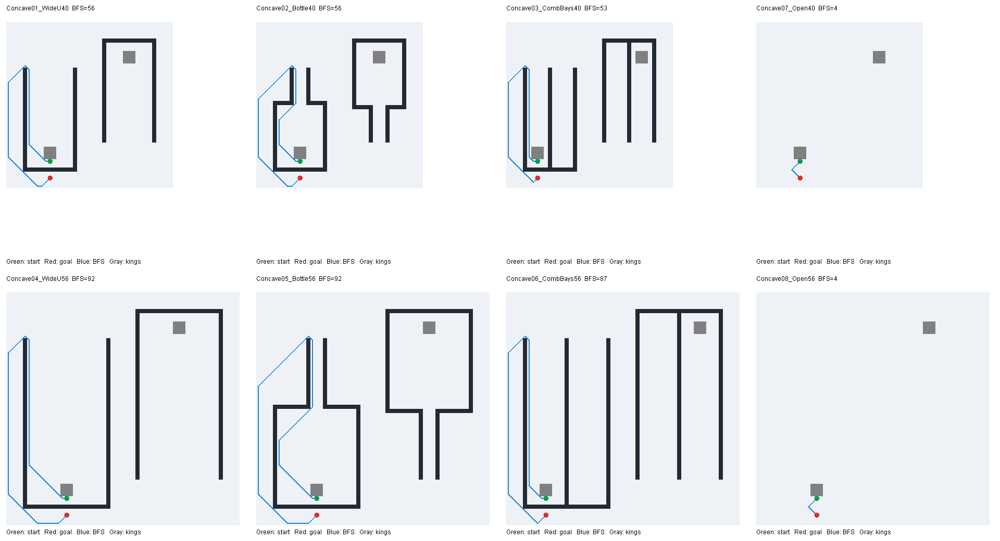
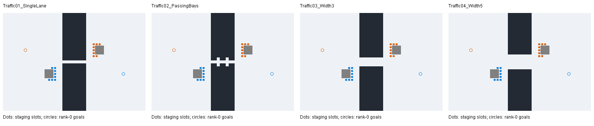

# Battlecode 2026 Path Planning

This project evaluates low-bytecode path planners for MIT Battlecode 2026. It
contains four minimal bots with identical high-level behavior, reproducible test
maps, and a replay analyzer that compares observed routes with optimal static-map
paths.

Each bot uses one stationary rat king and one baby rat:

- The king stays on its cheese mine, collects nearby cheese, and builds exactly
  one baby rat.
- The baby chooses deterministic random destinations and delegates movement to
  the selected path planner.
- Movement explicitly turns first and calls `moveForward()` only after checking
  legality.

The project currently uses Battlecode engine `1.2.6`, client `1.0.7`, and Java
21.

## Path planners

### IvanGeffner-derived BugNav (`pathplanner`)

`src/pathplanner/BugNav.java` adapts the obstacle tracking, wall-following side
selection, target reset, and loop-state logic from Ivan Geffner's
[BC26 BugNav implementation](https://github.com/IvanGeffner/BC26/blob/70b3f40cebefcca9dc858771715d78088e7ae520/basic51/BugNav.java).

This planner is fast and usually takes direct routes, but its map-edge side
switching has a static single-agent counterexample documented below.

### Classical Bug2 (`classicbug2`)

`src/classicbug2/ClassicBug2.java` is a grid adaptation of classical Bug2. Bug2
was selected instead of Bug1 because it needs less state and does not require a
complete boundary traversal followed by a second traversal to the best leave
point.

The implementation maintains:

- the start-to-goal m-line;
- an obstacle hit point and hit-point distance;
- a fixed boundary-following handedness for each encounter;
- explicit contact with the most recently observed blocked tile; and
- a leave condition requiring a closer m-line crossing.

Map edges are treated as ordinary obstacle boundaries. An unreachable target is
reported only after returning to the hit point following a complete boundary
traversal. Classical completeness assumptions still require static obstacles;
another moving robot can invalidate them.

### Real-Time Adaptive A* (`rtaa`)

`src/rtaa/RealTimeAdaptiveAStar.java` implements bounded Real-Time Adaptive A*
(RTAA*) over the eight-neighbor grid. Each movement turn it:

- records newly sensed passable and blocked terrain;
- runs a limited A* lookahead from the rat's current location;
- selects the lowest-`f` frontier state and takes the first step toward it; and
- updates every expanded state's heuristic to `f* - g(s)`.

The adaptive heuristic persists while pursuing the same target. Unknown tiles
are optimistically treated as passable, while sensed static walls remain in a
compact byte-array map. Search state uses preallocated primitive arrays and a
binary heap. Its hot path uses unrolled eight-neighbor expansion,
generation-stamped map arrays, and one packed `f`/`h`/state heap key. Direction
conversion uses the engine's one-cost `Direction.fromDelta`, and movement
avoids redundant legality checks.

The lookahead is capped at 14 node expansions per turn and also stops if fewer
than 4,000 bytecodes remain. Fourteen was selected by the deterministic
comb/spiral sweep below: it had the highest completion count, best aggregate
stretch, and lower bytecode usage than the saturated 16-expansion run. The
largest measured turn in that sweep used 16,893 of the 17,500-bytecode limit.
RTAA* checks movement legality immediately before turning and moving, and falls
back to the best legal adjacent tile when the planned step is temporarily
occupied.

### Learning Real-Time A* (`lrta`)

`src/lrta/LearningRealTimeAStar.java` implements bounded-lookahead LRTA*, using
the [LSS-LRTA* local learning rule](https://idm-lab.org/bib/abstracts/Koen09a.html).
It builds a small A* search space, then learns each expanded state's shortest
local distance to a frontier state plus that frontier state's heuristic. A
reverse Dijkstra pass computes these values. At one expansion this reduces to
the ordinary LRTA* Bellman update, `h(s) = min(1 + h(neighbor))`; at larger
lookaheads it learns multiple states. This is explicitly the local-search-space
variant, rather than vanilla one-state-per-move LRTA*. Like this project's
RTAA*, it executes one step toward the selected frontier and replans next turn.

The king, random target stream, target rejection, indicator graphics, and
turn-before-move behavior are copied from `rtaa`; only the navigation module
changes. Learned values reset on target changes, while observed terrain persists.
Temporary robot occupancy is checked during execution, not learned as a wall.

Bytecode optimization follows the supplied
[MPBasic fast utilities and advice](https://github.com/battlecode-archive/2022-5-Musketeers/tree/main/src/MPBasic/fast)
and [engine method costs](https://github.com/battlecode/battlecode26/blob/master/engine/src/main/battlecode/instrumenter/bytecode/resources/MethodCosts.txt):

- OPEN is a sorted `StringBuilder` of one-character node IDs. Binary search
  finds insertion points; native `insert`, `deleteCharAt`, and `indexOf`
  replace heap shifts and the heap-position array. Priorities remain packed
  primitive `f`/`h`/state keys, preserving deterministic ordering.
- The direct state-to-node map and cached heuristics are also `StringBuilder`s.
  Zero denotes an unseen entry; node IDs and heuristics are stored as value
  plus one. One native `replace` resets each buffer, removing generation
  counters, bit masks on lookups, and Java loops over the map.
- Eight-neighbor search and learning loops are unrolled. Cached adjacency lets
  learning reuse search results without sensing or reconstructing coordinates.
- Neighbor discovery is inlined into expansion so all eight directions share
  local array references. Base Chebyshev values are lazily cached alongside
  learned values for the current target.
- Only expanded nodes participate in the learning pass; frontier values seed
  it directly. Dense minimum selection removes settled entries by swapping
  them out of the active prefix, halving its worst-case scan count to
  `k*(k+1)/2` and avoiding repeated settled-state checks.
- Terrain is sensed once per movement call. Fallback movement uses
  `Direction.rotateRight`, `MapLocation.add`, and `rc.onTheMap`, with no custom
  direction or dx/dy arrays. `Direction.fromDelta` consumes the adjacent
  first-step delta directly. `Clock.getBytecodesLeft` checks the budget. The linked
  `FastMinQueue` explicitly warns that it is buggy, so it is not imported.

The allocation ceiling is 32 expansions. Before each expansion, the planner
reserves `1500 + 350*k + 7*k*k` bytecodes for learning and movement, plus 2,000
for the next expansion, where `k` is the prospective expanded count. Thus the
actual lookahead adapts to the turn's remaining budget and local search cost.
These reserves are empirical bounds validated on the repository maps, not a
proof for arbitrary maps or future engine versions.

`lrtabench` uses the same fixed 200-round target schedule as `rtaabench`, with an
additional replay indicator recording distinct search expansions. The analyzer
adds an optional `expanded_states` trace column; absent telemetry stays blank.
Learning revisits those expanded nodes and is included in bytecode usage, but
is not counted as additional distinct expansions. Production `lrta` does not
emit this extra profiling indicator.

## Test maps

| Map | Purpose |
| --- | --- |
| `BugNavTest` | Standard symmetric wall barriers with gaps. |
| `BugNavAdversarial` | A 32×32 maze with 182 walls (17.8%), long one-tile corridors, and capped dead ends. |
| `BugNavSingleAgentTrap` | Minimal static boundary counterexample: a reachable three-step target separated by two relevant wall tiles. |

All maps contain cheese mines beneath the stationary kings and no cats or dirt.
The counterexample map contains rotationally mirrored tests for the two required
teams; the babies remain far apart and do not interact.

### Forty-map benchmark suite

`GeneratePathfindingMapSuite` reproducibly creates `PathSuite01` through
`PathSuite40`, covering five wall families with eight variants each:

- staggered barriers with offset gates;
- interconnected rooms with varied door placement;
- nested rings with paired entrances;
- comb obstacles with long dead ends; and
- nested spiral/U-shaped obstacles.

The suite varies map dimensions from 24 to 38 tiles and wall density from about
5% to 16%. Every layout is rotationally symmetric and unique. The generator
also clears generous king/spawn zones, places a cheese mine beneath each king,
uses a deterministic cheese seed verified to sustain the stationary kings for
the full 2,000 rounds, uses no cats or dirt, connects every passable tile to the
kings, and calls the engine's map validator before writing the map. Map names
are listed in `maps/path-suite-maps.txt`.

Map sources are under `test/maptools/`, and generated `.map26` files are under
`maps/`.

### Concave-obstacle stress suite

`GenerateConcaveMapSuite` adds six deliberately deep concave obstacles and two
open controls, listed in `maps/concave-suite-maps.txt`. Each of three families
has a 40x40 and a 56x56 version: a wide U, a large chamber with a narrow exit
neck (`Bottle`), and a pair of broad comb bays. All maps are rotationally
symmetric, contain no dirt or cats, and have connected free space after blocking
the stationary kings. The generator validates connectivity and engine legality;
it never repairs walls by opening shortcuts. Initial cheese piles supplement
the kings' mines, and the analysis checks that every trial lasts 2,000 rounds.



The controlled escape starts at the bottom of a pocket with the target just
outside its closed end. Chebyshev distance is four on every map; BFS distance
is 53–92 on the traps and four on the controls. The trap interiors range from
111 to 751 free cells. Exact coordinates, areas, and BFS lengths are recorded
in `maps/concave-scenarios.json`.

`concavertaabench`, `concavelrtabench`, `concavebugnavbench`, and
`concavebug2bench` run identical fresh-state single-agent
trials using the production planner classes. Only team A builds a baby; team B
keeps a stationary king. These trials have identical starts, goals, terrain,
initial knowledge, and available rounds, without moving-robot interference.
Separately, `rtaabench`, `lrtabench`, `bugnavbench`, and `bug2bench` run their shared
200-round target schedules with one baby per team. Later starting positions
and accumulated terrain knowledge can differ in that exploration test.

Run `tools/benchmark_concavity.ps1` from PowerShell to regenerate the maps,
run all 64 matches, and produce `reports/concavity/*comparison.csv` plus the
per-episode source summaries in `reports/concavity/segments/`. Replays are
saved as `matches/concavity-<bot>-on-<map>.bc26`; full traces remain under
`analysis/concavity/`. `node tools/analyze_concavity.mjs` recomputes the reports
and checks starts/goals, independent generator/replay BFS agreement, movement
counts, shared target schedules, and complete observation horizons.

### Multi-agent corridor traffic suite

`GenerateTrafficMapSuite` creates four 48x33 maps with two chambers joined by
an eight-cell-long passage: one lane, one lane with two passing bays, three
lanes, and five lanes. Kings are outside the crossing routes. Maps have no
dirt or cats, are rotationally symmetric, and pass the engine validator and
free-space connectivity check.



Each map gets five traffic patterns: one solo robot from each direction in
separate runs, eight robots moving one way, two opposing robots, and eight
opposing robots (four per side). The three unchanged production planners are
BugNav, RTAA*, and LSS-LRTA*. Every robot uses the shared `TrafficTrial` driver;
there is no priority, reservation, yielding, attacking, or pushing policy.
Robots build at fixed staging coordinates, wait until round 25, receive fixed
distinct destinations beyond the passage, then park upon arrival. Two teams
provide opposite traffic directions; match winner is not a performance metric.

There are 20 scenarios and **60 matches**. The measurement window is rounds
25 through 600 inclusive, giving 575 movement opportunities after assignment.
The kings disintegrate on round 601 to end the match because map serialization
does not retain the requested shorter engine round limit. Analysis explicitly
clips traces to round 600; archived engine summaries may include round 601.

The static eight-neighbor BFS baseline blocks walls and king footprints but
ignores traffic, so it is an individual distance lower bound, not a joint
multi-agent optimum. Separately, an offline scheduler constructs and verifies
a collision-free serial plan with all waiting and parked robots treated as
occupied. Every scenario has such a plan within 206 movement rounds, below
the experiment's travel limit. These are feasible grid schedules, not measured
performance of a fourth bot. Full paths are saved in
`reports/traffic/feasible-schedules.json`.

`tools/benchmark_traffic.ps1` regenerates maps, checks schedule feasibility,
runs the matches, and analyzes their replays. `tools/analyze_traffic.mjs`
checks the exact agent counts, starts, goals, release round, paired robot IDs,
complete observation windows, collision-free snapshots, and agreement between
the generator, replay analyzer, and independent BFS. It reports completion,
completed-route stretch, travel time with unfinished routes capped at 575,
waiting, revisits, and bytecodes. A no-progress flag means an unfinished robot
has not improved its best static BFS distance for at least 100 rounds; it does
not prove a permanent deadlock. Stationary turns near another robot inside
the corridor are an observational proximity metric, not proof of blocking.
The rank-0 robots also have exact same-start/goal solo controls in each direction.

## Replay-based performance analysis

`test/pathanalysis/PathPerformanceAnalyzer.java` reads the engine's gzip-wrapped
FlatBuffer replay. Per-round path collection therefore consumes no bot
bytecodes. A baby emits only one `PATH_TARGET` indicator when its target changes.
The RTAA* and LRTA* babies additionally redraw a magenta indicator dot on the current goal
each round so the destination remains visible during replay playback.

The analyzer writes generated CSVs under `analysis/`:

- `path-trace.csv`: round, location, facing, cooldowns, engine-measured
  bytecodes, active target, and segment ID.
- `path-summary.csv`: actual and optimal steps/rounds, detour, path efficiency,
  completion status, total bytecodes, mean/peak bytecodes per turn, and
  bytecodes per movement step.

The optimal baseline is an eight-neighbor BFS over static passability. Walls,
dirt, and initial robot footprints are blocked; dynamic robot collisions are
included in actual performance but intentionally excluded from the optimum.

## Current results

These are 2,000-round engine runs. Production bots' random target streams diverge
after planners finish or reject targets at different times. Fixed-schedule tests
share targets but can have different later starting positions; the fresh-state
escape tests below pair both start and goal exactly.

### Multi-agent congestion comparison (2026-11-14)

All **60 corrected experiments and 240 agent trips complete successfully**.
These cases reproduce extra movement and slower completion for BugNav, but
do not reproduce a persistent deadlock. Pilot runs with a king on a crossing
route were discarded: that exposed an unrelated stationary-king oscillation
in RTAA*. The final maps move the kings away and include solo controls in
both directions. Only the corrected runs are in the traffic reports.

With eight opposing robots, elapsed rounds from the shared target assignment
until **every robot arrives** (lower is better):

| Passage | BugNav | RTAA* | LRTA* |
| --- | ---: | ---: | ---: |
| One lane | 106 | 86 | **59** |
| One lane with passing bays | 100 | 50 | **47** |
| Three lanes | 53 | **28** | 44 |
| Five lanes | 52 | **29** | 43 |

On the one-lane case, LRTA* reduces the last-arrival time by 44.3% relative to
BugNav; RTAA* reduces it by 18.9%. The average per-agent travel times are
72.75, 57.38, and 45.38 rounds for BugNav, RTAA*, and LRTA* respectively.
Their total movement is 576, 443, and 353 steps against the same combined
individual BFS minimum of 196: stretches of 2.94x, 2.26x, and 1.80x.

BugNav's penalty is primarily **extra movement rather than standing still**.
On that one-lane trial it makes 215 revisiting moves and accumulates six
stationary robot-rounds; RTAA* makes 190 revisits with 16 stationary rounds,
and LRTA* makes 101 revisits with ten stationary rounds. Wider corridors reduce
the contention cost. Passing bays help RTAA* and LRTA* more than BugNav in
these particular runs.

Solo controls matter because static routing performance already differs.
For the same rank-0 robot entering the one-lane map from the left:

| Planner | Alone | With seven other opposing robots | Added rounds | Slowdown |
| --- | ---: | ---: | ---: | ---: |
| BugNav | 48 | 96 | 48 | 2.00x |
| RTAA* | 26 | 86 | 60 | 3.31x |
| LRTA* | 48 | 58 | 10 | 1.21x |

This isolates a substantial advantage for LRTA* on that matched trip, but
**does not show that BugNav always suffers the largest congestion penalty**:
RTAA* loses more time relative to its faster solo run. Direction matters too:
the right-side rank-0 robot takes 48 -> 54 rounds for BugNav, 26 -> 41 for RTAA*,
and 26 -> 47 for LRTA*. Full paired controls are saved rather than selecting
only the favorable direction.

Across all four layouts with eight opposing robots, the mean travel times
are 50.84 rounds for BugNav, 36.38 for RTAA*, and 34.75 for LRTA*. Aggregate
path stretches are 2.111x, 1.488x, and 1.435x. With eight robots moving one way,
the difference is smaller: 37.72, 34.59, and 34.56 rounds per robot. BugNav
even has the shortest last-arrival time on the three- and five-lane one-way
cases (49 and 48 rounds). Neither learning planner dominates every traffic case.

The latency improvement costs bytecodes. In the eight-opposing-robot trials,
mean bytecodes per active target turn are approximately 417 for BugNav, 13,832
for RTAA*, and 13,167 for LRTA*. Overall measured peaks are 3,761, 17,095, and
16,414 respectively. There are no bytecode-limit hits across 138,240 measured
robot-turns and no logged bot exceptions. All full-window, paired-schedule,
BFS, movement, and feasibility checks pass.

These are deterministic synthetic tests with fixed geometry, traffic, and
execution order. They support a congestion-efficiency weakness for BugNav
on the narrow cases, not a general claim that it deadlocks or is always less
robust. None of the three planners implements cooperative traffic scheduling.

Results: [per-trial comparison](reports/traffic/trials.csv),
[individual robots](reports/traffic/agents.csv),
[matched solo controls](reports/traffic/matched-controls.csv), and
[aggregates](reports/traffic/aggregate.csv).
Reproduce with `tools/benchmark_traffic.ps1`. For replay inspection, the
one-lane eight-robot files are
`matches/traffic-trafficbugnavopposed8-on-Traffic01_SingleLane.bc26`,
`matches/traffic-trafficrtaaopposed8-on-Traffic01_SingleLane.bc26`, and
`matches/traffic-trafficlrtaopposed8-on-Traffic01_SingleLane.bc26`.

### BugNav and Bug2 on the concave suite (2026-11-14)

The follow-up adds 32 engine matches using the same eight maps, single-agent
starts/goals, and fixed target schedules. The production planner classes are
unchanged; the new entry points only supply the shared benchmark behavior.
The saved RTAA*/LRTA* source and map hashes were checked before reusing their
results. All four planners now appear in the comparison CSVs.

Fresh-state movement steps, with the same 2,000-round horizon:

| Map | BFS | BugNav | Bug2 | RTAA* | LRTA* |
| --- | ---: | ---: | ---: | ---: | ---: |
| Wide U, 40x40 | 56 | 62 | 63 | 629 | 422 |
| Bottle, 40x40 | 56 | 68 | 69 | 473 | 338 |
| Comb bays, 40x40 | 53 | 56 | 115 | 253 | 142 |
| Wide U, 56x56 | 92 | 102 | 103 | unfinished | 1,558 |
| Bottle, 56x56 | 92 | 116 | 117 | unfinished | 1,482 |
| Comb bays, 56x56 | 87 | 92 | 191 | 1,349 | 1,479 |

BugNav and Bug2 finish all six traps, and both finish the two open controls in
the optimal four steps. On the six traps their total path lengths are 496 and
658 respectively, against a combined BFS minimum of 436: **1.138x stretch for
BugNav and 1.509x for Bug2**, versus LRTA*'s 12.433x. RTAA* completes four of
six, so its completed-only aggregate is not comparable over the full suite.

Neither wall-following planner revisits a previously occupied cell in any of
these fresh escape routes. This contrasts with 3,319 revisiting moves across
LRTA*'s 5,421 steps. Bug2's larger comb detours come from following the boundary
into the adjacent bay: 51 rounds in the small comb and 87 in the large comb,
versus zero for BugNav. On the large comb, both first leave the starting bay
after 45 rounds, but Bug2 ultimately takes 191 steps versus BugNav's 92.

The separate changing-target experiment uses 200-round windows. All planners
receive 120 assignments on the six traps, of which 109 have reachable targets:

| Planner | Reachable goals completed | Completed-route stretch | Mean bytecodes / active target turn |
| --- | ---: | ---: | ---: |
| BugNav | 99/109 (90.8%) | 1.735x | 669 |
| Bug2 | 92/109 (84.4%) | 2.091x | 371 |
| RTAA* | 70/109 (64.2%) | 1.623x | 14,324 |
| LRTA* | 83/109 (76.1%) | 1.510x | 14,006 |

**Completion and stretch must be read together.** The completed episode sets
and later starting positions differ, so these stretch values do not establish
that LRTA* takes shorter paths on identical tasks. BugNav completes 16 more
reachable assignments than LRTA*, and Bug2 completes nine more. Active-target
bytecode means include stalled turns until retargeting; they are not isolated
planner-call costs. All four finish 40/40 open-control assignments; their
aggregate stretches are 1.000x, 1.004x, 1.005x, and 1.005x in the table's order.

The new BugNav runs peak at 7,841 bytecodes and Bug2 at 565. No bytecode-limit
hits occur in the 95,952 new measured baby turns (191,904 across all four
planners). All 64 matches pass the analysis checks for complete horizons,
paired targets, and trace movement counts; fresh trials also agree with the
generator's independent BFS baseline. The benchmark logs contain no bot
exceptions. These synthetic traps strongly favor wall following, but this
does not establish a universal ranking on other geometry or target streams.

Data: [all-planner escape table](reports/concavity/escape-all-planners.csv),
[escape details](reports/concavity/escape-comparison.csv),
[exploration by map](reports/concavity/exploration-comparison.csv), and
[aggregate results](reports/concavity/aggregate-comparison.csv).
Run `tools/benchmark_concavity.ps1` to reproduce all four planners; the
per-episode summaries and source hashes are retained in `reports/concavity/`.

### Large concave obstacles (2026-11-12)

The fresh-state tests reproduce the large-dead-end problem. LRTA* reaches all
six trap goals within the horizon; RTAA* reaches four. Both solve both open
controls optimally. Movement steps (lower is better):

| Map | BFS | RTAA* | LRTA* |
| --- | ---: | ---: | ---: |
| Wide U, 40x40 | 56 | 629 | 422 |
| Bottle, 40x40 | 56 | 473 | 338 |
| Comb bays, 40x40 | 53 | 253 | 142 |
| Wide U, 56x56 | 92 | unfinished: 1,998 | 1,558 |
| Bottle, 56x56 | 92 | unfinished: 1,998 | 1,482 |
| Comb bays, 56x56 | 87 | 1,349 | 1,479 |
| Open, 40x40 | 4 | 4 | 4 |
| Open, 56x56 | 4 | 4 | 4 |

Unfinished counts are movement already spent, **not completed path lengths**.
On the four traps completed by both planners, total steps decrease from 2,704
to 2,381 (11.9%). On the three smaller traps alone, the reduction is 33.4%.
LRTA* still has large detours: the large U and bottle require 16.9x and 16.1x
their BFS minima. RTAA* never leaves those two starting pockets before cutoff;
LRTA* first exits after 1,500 and 1,430 rounds from target assignment.

The large comb is a counterexample to a universal LRTA* advantage: its route
is 9.6% longer. LRTA* first exits the starting bay after 690 rounds versus
RTAA*'s 1,302, but then spends **731 rounds inside the adjacent dead-end bay**.
RTAA* does not enter that second bay. Thus faster escape from one pocket does
not guarantee a shorter complete route under partial observability.

The traces directly show repeated visits, rather than merely long necessary
detours. On the small U, 403 of RTAA*'s 629 moves revisit a previously occupied
cell (64.1%); LRTA* revisits on 219 of 422 moves (51.9%). On the large U,
RTAA* makes 1,485 revisiting moves without escaping, versus LRTA*'s 942 on its
completed route. Stationary turns do not count as revisits.

The separate fixed-schedule exploration test gives 120 assignments per planner
on the six traps. Eleven target locations are statically unreachable and are
excluded from completion denominators:

| Six concave maps, 200-round target windows | RTAA* | LRTA* |
| --- | ---: | ---: |
| Reachable goals completed | 70/109 (64.2%) | 83/109 (76.1%) |
| Completed-route stretch, sum(steps)/sum(BFS) | 1.623x | 1.510x |
| Mean bytecodes per active target turn | 14,324 | 14,006 |

LRTA* improves completion on all six maps, by 11.9 percentage points overall.
The stretch figures describe different completed episode sets and are **not a
paired improvement estimate**; later start positions also differ. On the open
controls, both complete 40/40 assignments and have identical 1.005x aggregate
stretch. This contrasts with the substantial completion losses on the traps.

Across all 32 matches, none of the 95,952 measured baby turns reaches the
17,500-bytecode limit. Peak usage is 16,956 for RTAA* and 16,550 for LRTA*.
LRTA* averages 9.75 expansions per measured planning turn on the six exploration
maps, with a maximum of 13. The fresh-state harnesses omit expansion telemetry.
All five repository unit tests pass; the analysis also verifies all trial
horizons and paired target schedules. Recorded data:
[paired escapes](reports/concavity/escape-pairs.csv),
[escape details and revisits](reports/concavity/escape-comparison.csv),
[exploration by map](reports/concavity/exploration-comparison.csv), and
[aggregates](reports/concavity/aggregate-comparison.csv).

These compare the current implementations: RTAA* has a 14-expansion ceiling;
LRTA* is the bounded-lookahead **LSS-LRTA*** variant, with a 32-expansion ceiling
and a bytecode-dependent stop condition. Their data structures and learning
costs differ. The results support a benefit on these particular traps, not a
claim that the backup rule alone caused it or that LRTA* wins on every concavity.
They are deterministic synthetic cases, not a statistical sample of all maps.

### LRTA* intrinsics and string storage (2026-11-11)

The next optimization pass uses the one-bytecode `StringBuilder.insert`,
`deleteCharAt`, `indexOf`, and `replace` entries in the linked method-cost
table, also verified in the installed 1.2.6 engine. The OPEN queue stores
sorted, unique UTF-16 node IDs. Binary search still compares numeric priorities;
native operations perform the shifting and ID lookup. The two direct-address
string buffers store node IDs and cached heuristics as value plus one, using
native bulk replacement to reset them. Direction rotation and map-location
intrinsics replace the fallback's direction and dx/dy tables.

The four-expansion comparison on `PathSuite04_Combs` and
`PathSuite05_Spirals` isolates bytecode savings from larger lookahead:

| Implementation | Bytecodes / completed-segment turn | Peak bytecodes |
| --- | ---: | ---: |
| Previous array/heap implementation | 7,081.0 | 10,295 |
| String-backed OPEN plus direction intrinsics | 6,539.0 | 9,384 |
| Also use a string-backed state-to-node map | 6,291.1 | 9,088 |
| Also use string-backed heuristic storage | **6,184.5** | **8,992** |

All 7,996 observed turns retained the same positions, directions, movement and
turning cooldowns, targets, and expansion counts. The final version saves
**12.7%** per completed-segment turn and **3,446,276 bytecodes** across those
two matches. The lookahead reserve remains `1500 + 350*k + 7*k*k`, plus 2,000
for the next expansion. See
[reports/lrta-intrinsics/fixed4/summary.csv](reports/lrta-intrinsics/fixed4/summary.csv).

A string-backed priority queue was also tested for the learning pass. It was
slower than the compact scan on these small local search spaces and hit the
bytecode limit twice in the adaptive-lookahead pilot, so that variant is not
used. Primitive arrays remain for terrain and local search scratch. Tests
cover queue insert/decrease/pop against an independent reference, node IDs
0/255/256, UTF-16 buffer resets, preservation of learning across search resets,
and the existing independent shortest-path learning oracle.

Across all 43 maps, the fixed-schedule comparison matched all 860 target
assignments against the previous optimized version. The reserve and allocation
ceiling were unchanged, so these gains come from the data structures and
intrinsics rather than a more aggressive budget threshold.

| Fixed-schedule metric, all 43 maps | Previous optimized version | Intrinsics/string version |
| --- | ---: | ---: |
| Mean expansions per turn with search work | 7.59 | **8.76** |
| Maximum expansions | 14 | **15** |
| Full planning-turn bytecodes per expansion | 1,726.8 | **1,446.8** |
| Reached / reachable assignments | 738 / 758 | **742 / 758** |
| Aggregate completed-route stretch versus BFS | 1.467× | **1.413×** |
| Mean bytecodes / completed-segment turn | 12,528.0 | **11,949.1** |
| Peak bytecodes, all observed turns | 17,086 | **16,682** |
| Turns at the 17,500-bytecode limit | 0 / 171,914 | 0 / 171,914 |

Mean lookahead increased 15.5% and bytecodes per expansion decreased 16.2%.
The route-quality aggregation still includes only completed reachable
assignments, so membership and episode start positions may differ between
versions. Results are saved in
[reports/lrta-intrinsics/lrtabench/summary.csv](reports/lrta-intrinsics/lrtabench/summary.csv).

The production explorer also completed all 43 maps: 5,305 / 5,394 reachable
assignments reached (98.35%), 1.382× aggregate stretch, and 11,582.7 bytecodes
per completed-segment turn. The previous version measured 98.12%, 1.417×,
and 12,221.1 respectively; these production target streams are not paired.
There were no reachable-stalled assignments. Peak production usage was 16,700.
Across the **86 final validation matches**, all 343,828 baby turns stayed
below the bytecode limit and the verbose logs contained no bot exceptions.
All four correctness tests passed after validation, including 100 independent
learning-graph cases and 2,000 randomized queue operations. Production details:
[reports/lrta-intrinsics/lrta/summary.csv](reports/lrta-intrinsics/lrta/summary.csv).

```powershell
.\tools\benchmark_lrta_expansions.ps1 -Expansions 4 -Limit 2 -OutputRoot analysis/lrta-intrinsics/fixed4 -ReplayPrefix lrta-intrinsics-fixed4
.\tools\benchmark_path_suite.ps1 -Bots lrtabench,lrta -AllMaps -VerboseBots -OutputRoot analysis/lrta-intrinsics/allmaps -ReplayPrefix lrta-intrinsics -FailOnBytecodeLimit
node tools/summarize_path_benchmarks.mjs analysis/lrta-intrinsics/allmaps/lrtabench reports/lrta-intrinsics/lrtabench
node tools/summarize_path_benchmarks.mjs analysis/lrta-intrinsics/allmaps/lrta reports/lrta-intrinsics/lrta
```

### First LRTA* bytecode optimization (2026-11-11)

The optimized planner caches target-specific base heuristics, shares array
references across inlined neighbor expansions, and removes settled entries
from the learning scan. Learning still computes the same LSS-LRTA* values.
The cheaper backup permits reducing the learning reserve from
`1500 + 550*k + 12*k*k` to `1500 + 350*k + 7*k*k`, while retaining the 2,000
bytecodes reserved for the next complete search expansion.

At a fixed **four-expansion** ceiling on `PathSuite04_Combs` and
`PathSuite05_Spirals`, all 7,996 observed turns retained identical positions,
directions, cooldowns, targets, and expansion counts. Mean bytecodes per
completed-segment turn fell from **8,207.3 to 7,081.0 (13.7%)**; peak usage
fell from 11,786 to 10,295. The two matches saved 4,480,997 bytecodes overall.
See [fixed-cap results](reports/lrta-optimization/fixed4/summary.csv).

The production setting spends those savings on additional lookahead. Both
versions received the same 860 scheduled target episodes across all 43 maps;
every assignment matched by robot, round, and target coordinates.

| Fixed-schedule metric, all 43 maps | Initial LRTA* | Optimized LRTA* |
| --- | ---: | ---: |
| Mean expansions per turn with search work | 6.06 | **7.59** |
| Maximum expansions in a turn | 11 | **14** |
| Full planning-turn bytecodes per expansion | 2,085.7 | **1,726.8** |
| Reached / reachable assignments | 729 / 758 | **738 / 758** |
| Aggregate completed-route stretch versus BFS | 1.554× | **1.467×** |
| Exactly optimal completed routes | 401 | **443** |
| Mean bytecodes / completed-segment turn | 12,213.5 | 12,528.0 |
| Peak bytecodes, all observed turns | 16,695 | 17,086 |
| Turns reaching the 17,500-bytecode limit | 0 / 171,914 | 0 / 171,914 |

Average lookahead increased **25.3%**, and bytecodes per expansion decreased
**17.2%**. Total turn usage can increase because the default planner reinvests
the savings in more search. Near-goal turns stop early and can still expand
fewer than four states. Stretch covers completed reachable assignments, whose
membership and starting positions can differ even under matching target
schedules. The previous measurements remain intact in `reports/lrtabench/`;
the new per-map results are in
[reports/lrta-optimization/lrtabench/summary.csv](reports/lrta-optimization/lrtabench/summary.csv).

The ordinary `lrta` explorer was also rerun on all 43 maps. It reached
5,054 / 5,151 reachable assignments (98.12%, versus 98.21% initially), with
1.417× aggregate stretch (previously 1.508×) and a 16,974-bytecode peak.
These are aggregate comparisons: production random-target streams diverge as
completion times change. There were no reachable-stalled assignments, and the
19 reachable retargets were unchanged in count. Across both validation runs,
all **343,828 baby turns** stayed below the limit, with no bot exceptions in
the verbose logs. The correctness tests passed after the final configuration
was restored. Production results are in
[reports/lrta-optimization/lrta/summary.csv](reports/lrta-optimization/lrta/summary.csv).

Reproduce the optimization checks without overwriting the earlier results:

```powershell
.\tools\benchmark_lrta_expansions.ps1 -Expansions 4 -Limit 2 -OutputRoot analysis/lrta-optimization/fixed4 -ReplayPrefix lrta-opt-fixed4
.\tools\benchmark_path_suite.ps1 -Bots lrtabench,lrta -AllMaps -VerboseBots -OutputRoot analysis/lrta-optimization/allmaps -ReplayPrefix lrta-optimized -FailOnBytecodeLimit
node tools/summarize_path_benchmarks.mjs analysis/lrta-optimization/allmaps/lrtabench reports/lrta-optimization/lrtabench
node tools/summarize_path_benchmarks.mjs analysis/lrta-optimization/allmaps/lrta reports/lrta-optimization/lrta
```

### Initial LRTA* on all 43 repository maps (2026-11-10)

The production `lrta` bot ran both teams for 2,000 rounds on every `.map26` in
`maps/`: the forty-map suite plus the three BugNav maps. Per-map and family
aggregates are saved in [reports/lrta/summary.csv](reports/lrta/summary.csv).
Detailed per-turn and per-target CSVs remain in `analysis/suite/lrta/`, and the
engine replays remain in `matches/`.

| Maps | Reached / reachable | Raw completion | Actual / BFS-optimal steps | Aggregate stretch | Mean efficiency | Bytecodes / turn | Peak bytecodes |
| --- | ---: | ---: | ---: | ---: | ---: | ---: | ---: |
| All 43 | 4,932 / 5,022 | 98.21% | 122,627 / 81,293 | 1.508× | 0.896 | 11,980.9 | 16,633 |
| Forty-map suite | 4,448 / 4,533 | 98.12% | 115,740 / 75,195 | 1.539× | 0.889 | 12,047.1 | 16,617 |
| BugNavTest | 199 / 200 | 99.50% | 2,393 / 2,326 | 1.029× | 0.980 | 10,421.9 | 16,617 |
| BugNavAdversarial | 87 / 87 | 100.00% | 2,501 / 1,890 | 1.323× | 0.845 | 11,925.6 | 16,167 |
| BugNavSingleAgentTrap | 198 / 202 | 98.02% | 1,993 / 1,882 | 1.059× | 0.989 | 10,261.3 | 16,633 |

Path quality and mean bytecodes above cover completed reachable assignments.
Peak bytecodes cover **all** observed baby turns. Across all 43 maps, none of
171,914 turns reached the 17,500 limit; mean usage over all turns was 12,239.5.
There were 71 reachable assignments unfinished at match end, 19 retargeted
assignments, and no reachable targets classified as stalled. Of completed
reachable routes, 3,049 (61.82%) were exactly BFS-optimal.

The trap-map row uses the ordinary random-target bot, not the special fixed
three-step counterexample assignment. Random target streams also diverge
between planners as completion times change, so the earlier three-planner
tables below are historical aggregate context, not a paired comparison with
this LRTA* run. The BFS reference assumes unit-cost eight-neighbor movement,
static terrain and initial king footprints; it excludes moving robots and
does not make the planner omniscient.

### Initial LRTA* expansion measurements (2026-11-10)

A separate `lrtabench` run covered all 43 maps with ten fixed 200-round target
episodes per baby. It reached 729 of 758 reachable assignments (96.17%), with
1.554× aggregate stretch on completed reachable assignments. This stricter
200-round completion window differs from the production explorer above.
The run expanded 280,007 states over 46,217 turns with nonzero search work:
**6.06 expansions per planning turn on average, 11 maximum**. Near-goal turns
stop early, so that average is not the maximum sustainable lookahead.
Peak usage was 16,695, with zero bytecode-limit hits in 171,914 turns.
See [reports/lrtabench/summary.csv](reports/lrtabench/summary.csv).

An additional cap sweep on `PathSuite04_Combs` and `PathSuite05_Spirals` checked
whether the allocation ceiling constrained throughput. Each setting had 40
episodes, 33 reachable; all 160 target comparisons against the cap-32 run
matched by robot, assignment round, and target coordinates.

| Expansion ceiling | Reached / reachable | Mean / maximum expansions per planning turn | Aggregate stretch | Peak bytecodes |
| ---: | ---: | ---: | ---: | ---: |
| 1 (one-step LRTA*) | 24 / 33 | 1.00 / 1 | 2.385× | 4,574 |
| 4 | 28 / 33 | 3.96 / 4 | 2.375× | 11,786 |
| 8 | 32 / 33 | 6.58 / 8 | 2.258× | 16,360 |
| 16 | 32 / 33 | 6.58 / 8 | 2.258× | 16,360 |
| 32 | 32 / 33 | 6.58 / 8 | 2.258× | 16,360 |

The reserve, rather than the larger caps, limits search on these two maps.
Other maps allowed up to 11 expansions; the production allocation ceiling
remains 32 so it does not impose an eight-state limit. This is measured
saturation under the current reserve, not a claim of globally optimal bytecode
allocation. Summaries are in `reports/lrta-expansion-sweep/e*/summary.csv`;
reproduce this smaller sweep with `benchmark_lrta_expansions.ps1 -Limit 2`.
The full default sweep covers all sixteen comb/spiral maps.

In the CSVs, expansion statistics exclude turns without search work, and
`planning_bytecodes_per_expansion` includes sensing, learning, movement, and
profiling overhead in those turns. Missing production telemetry is left blank.
Tests independently check the learning rule against shortest-path distances
on 100 local graphs, the one-step Bellman case, and target-reset invalidation.

### Deterministic RTAA* expansion sweep

The `rtaabench` package assigns a new pseudo-random target on fixed 200-round
boundaries. Each target is a pure function of map dimensions, baby spawn, and
episode number, so planner progress cannot alter later assignments. Across all
nine expansion settings, all 2,560 cross-setting target comparisons matched.

The sweep covers the eight comb and eight spiral maps: 320 fixed target episodes
per setting, of which 283 are statically reachable. Stretch is total actual
steps divided by total optimal steps over completed reachable episodes.

| Expansions | Reached / reachable | Completion | Aggregate stretch | Bytecodes / turn | Peak bytecodes |
| ---: | ---: | ---: | ---: | ---: | ---: |
| 5 | 237 / 283 | 83.7% | 2.170× | 6,948.6 | 11,621 |
| 6 | 241 / 283 | 85.2% | 2.100× | 8,049.3 | 13,621 |
| 7 | 244 / 283 | 86.2% | 2.000× | 9,085.6 | 15,657 |
| 8 | 245 / 283 | 86.6% | 2.080× | 10,101.3 | 16,891 |
| 9 | 254 / 283 | 89.8% | 1.990× | 10,870.7 | 16,893 |
| 10 | 256 / 283 | 90.5% | 1.960× | 11,674.0 | 16,893 |
| 12 | 253 / 283 | 89.4% | 1.880× | 12,647.2 | 16,893 |
| **14** | **262 / 283** | **92.6%** | **1.800×** | **12,970.3** | **16,893** |
| 16 | 262 / 283 | 92.6% | 1.840× | 13,059.4 | 16,979 |

At the same cap of five on `PathSuite04_Combs`, bytecode optimization preserved
the exact 10 completed routes (454 actual versus 176 optimal steps) while
reducing mean usage from 9,114.7 to 7,092.5 bytecodes per turn (22.2%) and the
peak from 14,516 to 11,468 (21.0%).

### Forty-map suite

This earlier cross-planner suite used the pre-optimization five-expansion RTAA*
configuration; it is retained as the like-for-like three-planner baseline.

The full suite comprises 120 matches: each of the three planners ran for 2,000
rounds on all 40 maps. A target assignment is *reachable* when the analyzer's
static eight-neighbor BFS finds a path. Random targets that land on walls are
excluded. `Reached / reachable` is the raw completion count; `adjusted` also
excludes reachable targets assigned too near round 2,000 to finish.

| Planner | Reached / reachable | Raw completion | Match-ended | Retargeted | Adjusted completion |
| --- | ---: | ---: | ---: | ---: | ---: |
| Ivan-derived BugNav | 5,481 / 5,576 | 98.30% | 69 | 26 | 99.53% |
| Classical Bug2 | 3,582 / 3,878 | 92.37% | 74 | 222 | 94.16% |
| RTAA* (5 expansions) | 3,755 / 3,843 | 97.71% | 72 | 16 | 99.58% |

`Retargeted` means the bot changed away from a statically reachable target
before arriving. Dynamic occupancy can cause this for every bot; Bug2 may also
retarget after its boundary traversal declares the target unreachable. The
replay does not distinguish those causes, so this column should not be read as
a pure single-agent incompleteness count.

Path-quality metrics below include only completed reachable assignments.
Aggregate stretch is total actual steps divided by total optimal steps; lower is
better, and `1.000×` is optimal. Mean efficiency is the per-assignment mean of
`optimal / actual`, so higher is better.

| Planner | Actual / optimal steps | Aggregate stretch | Mean efficiency | Exactly optimal | Bytecodes / turn | Peak bytecodes |
| --- | ---: | ---: | ---: | ---: | ---: | ---: |
| Ivan-derived BugNav | 134,049 / 93,196 | 1.438× | 0.856 | 51.7% | 498.5 | 16,119 |
| Classical Bug2 | 113,180 / 59,009 | 1.918× | 0.742 | 35.1% | 352.7 | 671 |
| RTAA* (5 expansions) | 110,818 / 61,901 | 1.790× | 0.869 | 55.7% | 9,090.6 | 14,854 |

Bytecodes per turn are aggregated over completed reachable assignments. Peak
bytecodes include all 159,920 observed baby-rat turns per planner; none of the
three planners reached the 17,500-bytecode limit anywhere in the suite.

BugNav has the best aggregate path length and near-perfect adjusted completion.
RTAA* reaches the highest fraction of exact-optimal paths and has the best mean
efficiency, but a small number of very long comb/spiral routes raise its
aggregate stretch above BugNav. Bug2 uses the fewest bytecodes but has both the
lowest completion rate and longest routes.

Rooms and rings are the easiest structures: BugNav uses `1.09×` and `1.18×`
optimal steps, while RTAA* uses `1.07×` and `1.35×`. Combs and spirals are the
hardest. Their aggregate stretches are `2.12×`/`1.69×` for BugNav,
`2.88×`/`2.51×` for Bug2, and `2.89×`/`3.63×` for RTAA*, respectively.

### Standard map

| Planner | Reached / segments | Mean path efficiency | Bytecodes / turn | Bytecodes / step |
| --- | ---: | ---: | ---: | ---: |
| Ivan-derived BugNav | 246 / 280 | 0.915 | 342.7 | 368.0 |
| Classical Bug2 | 173 / 207 | 0.852 | 313.3 | 331.1 |
| RTAA* (5 expansions) | 192 / 221 | 0.959 | 8,515.8 | 9,192.5 |

### One-wide-corridor adversarial map

| Planner | Reached / segments | Mean path efficiency | Bytecodes / turn | Bytecodes / step |
| --- | ---: | ---: | ---: | ---: |
| Ivan-derived BugNav | 75 / 97 | 0.807 | 597.0 | 615.0 |
| Classical Bug2 | 48 / 73 | 0.640 | 395.9 | 403.7 |
| RTAA* (5 expansions) | 70 / 91 | 0.751 | 8,233.3 | 8,433.4 |

Bug2 is more conservative and produces longer routes, but it uses fewer
bytecodes—especially while following complex boundaries. RTAA* produces the
most efficient routes on the standard map and remains competitive in the
one-wide maze, at the expected cost of substantially more planning bytecodes.
Its measured peak was 14,838 bytecodes on the standard map and 14,532 on the
adversarial map.

### Static single-agent counterexample

For team A, the baby starts at `(0,5)`, targets `(0,2)`, and has walls at
`(0,3)` and `(0,4)`. The optimal route is:

```text
(0,5) -> (1,4) -> (1,3) -> (0,2)
```

| Planner | Result | Steps | Rounds | Mean bytecodes / observed turn |
| --- | --- | ---: | ---: | ---: |
| Ivan-derived BugNav | Stalls at `(1,4)` | 1 | 1,998 without arrival | 1,129.4 |
| Classical Bug2 | Reaches target | 3 | 3 | 313.4 |

The Ivan-derived module repeatedly flips its wall-following side when candidate
directions extend beyond the map boundary. Classical Bug2 preserves its
boundary-following orientation and completes the optimal route.

## Commands

On Windows, replace `./gradlew` with `.\gradlew.bat`.

```text
# Install/update dependencies and compile
./gradlew update build

# Run the default Ivan-derived bot on BugNavTest
./gradlew run

# Regenerate all custom maps
./gradlew generatePathfindingTestMap
./gradlew generateAdversarialPathfindingMap
./gradlew generateSingleAgentBugNavTrapMap
./gradlew generatePathfindingMapSuite

# Run and analyze Ivan-derived BugNav
./gradlew benchmarkPaths -PteamA=pathplanner -PteamB=pathplanner -Pmaps=BugNavAdversarial -PanalysisOutput=analysis/ivan/adversarial

# Run and analyze classical Bug2
./gradlew benchmarkPaths -PteamA=classicbug2 -PteamB=classicbug2 -Pmaps=BugNavAdversarial -PanalysisOutput=analysis/classic-bug2/adversarial

# Run and analyze Real-Time Adaptive A*
./gradlew benchmarkPaths -PteamA=rtaa -PteamB=rtaa -Pmaps=BugNavAdversarial -PanalysisOutput=analysis/rtaa/adversarial

# Run and analyze Learning Real-Time A*
./gradlew benchmarkPaths -PteamA=lrta -PteamB=lrta -Pmaps=BugNavAdversarial -PanalysisOutput=analysis/lrta/adversarial

# Reproduce the fixed-target comparison
./gradlew benchmarkPaths -PteamA=bugnavcounterexample -PteamB=bugnavcounterexample -Pmaps=BugNavSingleAgentTrap -PanalysisOutput=analysis/single-agent-trap
./gradlew benchmarkPaths -PteamA=classicbug2counterexample -PteamB=classicbug2counterexample -Pmaps=BugNavSingleAgentTrap -PanalysisOutput=analysis/classic-bug2/single-agent-trap

# Run all four planners on all 40 suite maps (160 analyzed matches)
.\tools\benchmark_path_suite.ps1

# Generate and benchmark all four planners on eight concavity maps (64 matches)
.\tools\benchmark_concavity.ps1

# Run the controlled multi-agent congestion experiments (60 matches)
.\tools\benchmark_traffic.ps1

# Benchmark LRTA* on every .map26 in maps/ (55 maps currently)
.\tools\benchmark_path_suite.ps1 -Bots lrta -AllMaps
node tools/summarize_path_benchmarks.mjs analysis/suite/lrta reports/lrta

# Fixed-schedule targets with expansion telemetry on every map
.\tools\benchmark_path_suite.ps1 -Bots lrtabench -AllMaps
node tools/summarize_path_benchmarks.mjs analysis/suite/lrtabench reports/lrtabench

# Run a smaller slice, useful for a smoke test
.\tools\benchmark_path_suite.ps1 -Start 1 -Limit 2

# Sweep deterministic RTAA* targets on every comb and spiral map
.\tools\benchmark_rtaa_expansions.ps1

# Sweep LRTA* lookahead ceilings (1, 4, 8, 16, 32) on comb/spiral maps
.\tools\benchmark_lrta_expansions.ps1
```

To analyze an existing replay without rerunning a match, use `analyzePaths` with
`-PanalysisReplay=<file>`, `-PanalysisMap=<name>`, and optionally
`-PanalysisOutput=<directory>`.

## Repository layout

```text
src/pathplanner/                 Ivan-derived BugNav bot
src/classicbug2/                 Classical Bug2 bot
src/rtaa/                        Real-Time Adaptive A* bot
src/lrta/                        Learning Real-Time A* (LSS-LRTA*) bot
src/lrtabench/                   Fixed-schedule LRTA* benchmark and telemetry
src/rtaabench/                   Fixed-schedule RTAA* benchmark bot
src/concavertaabench/            Single-agent concave escape with RTAA*
src/concavelrtabench/            Single-agent concave escape with LSS-LRTA*
src/concavebugnavbench/          Single-agent concave escape with BugNav
src/concavebug2bench/            Single-agent concave escape with Bug2
src/bugnavbench/                Fixed-schedule BugNav benchmark
src/bug2bench/                  Fixed-schedule Bug2 benchmark
src/trafficbench/               Shared synchronized multi-agent traffic driver
src/traffic*/                   Planner and traffic-pattern entry points
src/*counterexample/             Fixed-target comparison harnesses
maps/                            Generated Battlecode maps
test/maptools/                   Reproducible map generators
test/pathanalysis/               Replay and optimal-path analyzer
tools/benchmark_path_suite.ps1   Four-planner suite / all-map runner
tools/summarize_path_benchmarks.mjs
                                 Per-map and aggregate BFS comparison CSVs
reports/lrta/                    Recorded production LRTA* benchmark aggregates
reports/lrtabench/               Recorded fixed-target expansion measurements
reports/lrta-intrinsics/         Intrinsic/string optimization results
reports/concavity/               Map overview and paired concave-obstacle results
reports/traffic/                 Congestion results and feasible serial schedules
tools/benchmark_traffic.ps1     Reproduce the corridor traffic experiments
tools/analyze_traffic.mjs       Validate and quantify multi-agent congestion
tools/benchmark_concavity.ps1    Reproduce the complete concavity comparison
tools/analyze_concavity.mjs      Verify trials and quantify escapes and revisits
tools/benchmark_rtaa_expansions.ps1
                                 Deterministic RTAA* expansion sweep
tools/benchmark_lrta_expansions.ps1
                                 Deterministic LRTA* lookahead ceiling sweep
tools/search_bugnav_counterexample.mjs
                                 Static counterexample search harness
```

Generated clients, replays, builds, dependency caches, JVM socket scratch data,
and analysis CSVs are intentionally excluded by `.gitignore`.
